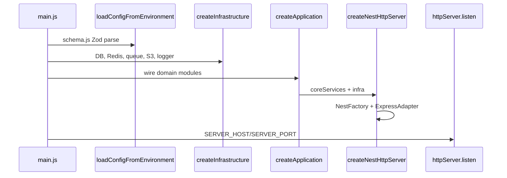
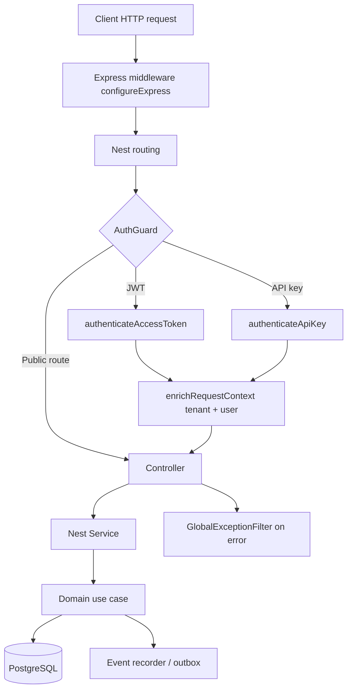
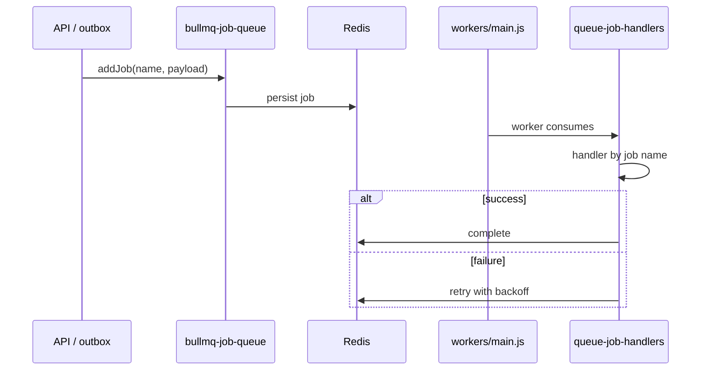
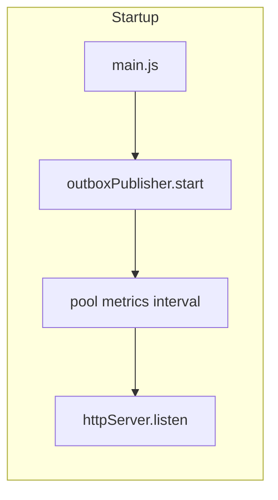
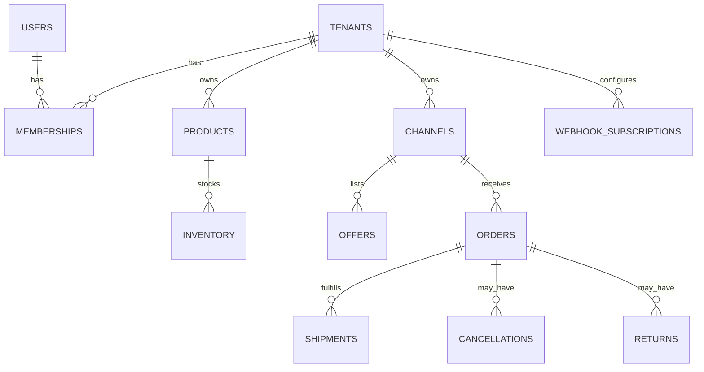
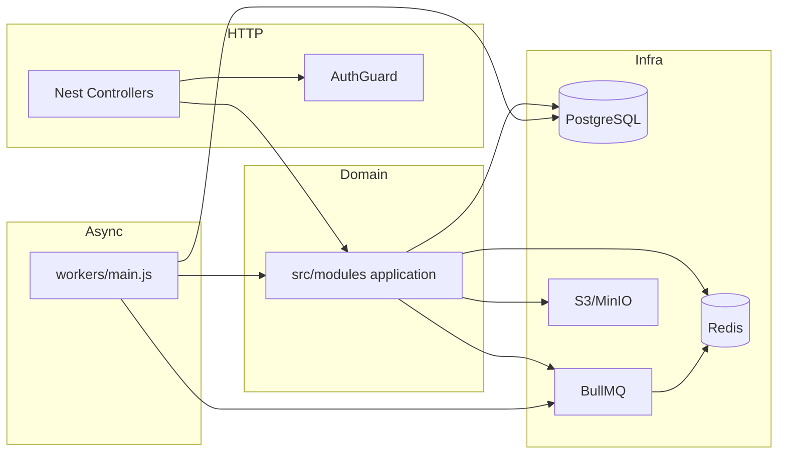

# Wasl Backend — Complete Architecture and Technology Guide

**Document classification:** Internal engineering reference  
**Repository:** `wasl-backend` (JavaScript ESM, Node.js ≥ 24)  
**Generated:** 2026-10-12  
**Scope:** Architecture, folder structure, technology stack, request flows, business modules, API inventory, configuration, database, queues, integrations, testing, operations, risks.

---

## Document purpose and scope

This guide describes the **actual** Wasl backend as implemented in this repository. It is intended for engineers onboarding from beginner to advanced level: what each major folder does, how NestJS and domain modules interact, and how HTTP requests, database access, queues, and webhooks flow through the system.

**Companion artifacts (full machine-readable inventories):**

| File | Contents |
| ---- | -------- |
| [Wasl_Backend_Source_File_Inventory.csv](./Wasl_Backend_Source_File_Inventory.csv) | Every `.js` / `.mjs` / `.cjs` under `src/`, `tests/`, `test/`, `scripts/` with a **layer** tag |
| [Wasl_Backend_Nest_Endpoint_Inventory.md](./Wasl_Backend_Nest_Endpoint_Inventory.md) | **159** HTTP routes from Nest `@Get/@Post/...` decorators |
| [Wasl_Backend_Environment_Variables.md](./Wasl_Backend_Environment_Variables.md) | Environment keys from `src/app/config/schema.js` |

**Excluded from source inventory:** `node_modules/`, build output, secrets in `.env`, and generated lockfile trees. **925** application-related source paths are listed in the CSV.

**Verification note:** Runtime behavior described here is derived from static analysis of source and configuration unless explicitly marked as execution-verified.

---

## Table of contents

1. [Repository overview](#1-repository-overview)
2. [Folder tree and layering](#2-folder-tree-and-layering)
3. [Technology stack](#3-technology-stack)
4. [NestJS and Express architecture](#4-nestjs-and-express-architecture)
5. [Request and job lifecycles](#5-request-and-job-lifecycles)
6. [Business modules](#6-business-modules)
7. [API endpoint reference](#7-api-endpoint-reference)
8. [Configuration and environment](#8-configuration-and-environment)
9. [Database structure](#9-database-structure)
10. [Testing and developer workflow](#10-testing-and-developer-workflow)
11. [Deployment and infrastructure](#11-deployment-and-infrastructure)
12. [Dependency and architecture map](#12-dependency-and-architecture-map)
13. [Architecture risks and documentation gaps](#13-architecture-risks-and-documentation-gaps)
14. [Glossary](#14-glossary)
15. [Coverage appendix](#15-coverage-appendix)

---

## 1. Repository overview

### 1.1 What Wasl backend is

Wasl is a **multi-tenant commerce and channel management platform**. The backend exposes REST APIs for tenants, products, inventory, channels, marketplaces, orders, fulfillment (shipments, cancellations, returns), webhooks, audit, authorization, and **merchant compatibility** layers (ChannelEngine-style and StockConnect integration paths).

### 1.2 Architectural style

The codebase follows a **modular monolith** (see `docs/decisions/ADR-001-modular-monolith.md`):

- **Domain modules** under `src/modules/*` — use cases, repositories, Zod schemas, legacy Fastify-style route modules (still present for wiring/tests in places).
- **HTTP adapter** under `src/app/*` — NestJS 11 controllers/services on **Express** (`@nestjs/platform-express`).
- **Composition root** — `src/app/create-application.js` wires domain modules and passes a `coreServices` object into Nest.
- **Infrastructure** — `src/infrastructure/*` (Postgres, Redis, BullMQ, S3, HTTP client, auth primitives).
- **Workers** — separate process `src/workers/main.js` consuming BullMQ jobs (catalog sync, marketplace lifecycle, webhook delivery, etc.).

### 1.3 Process model

| Process | Entry | Role |
| ------- | ----- | ---- |
| API | `src/app/main.js` | Loads config → infrastructure → `createApplication()` → Nest HTTP listen |
| Worker | `src/workers/main.js` | Same config/infra pattern; registers queue handlers + optional observability HTTP |
| Migrations CLI | `src/app/migrate-cli.js` | Applies SQL in `src/infrastructure/postgres/migrations/` |
| Standalone Nest bootstrap | `src/app/nest-bootstrap.mjs` | Alternate dev entry (`npm run dev:nest`); production path uses `main.js` |

### 1.4 Repository statistics (scan)

| Metric | Count |
| ------ | ----- |
| Directories (excluding `node_modules`, `.git`) | 280 |
| Files (same exclusion) | 1491 |
| `src/**/*.js` in inventory | 925 |
| SQL migrations | 47 |
| Domain modules (`src/modules/`) | 22 |
| Nest feature areas (`src/app/`) | 27 |
| Nest decorator routes (static scan) | 159 |
| Declared npm dependencies reviewed | 42 |

---

## 2. Folder tree and layering

### 2.1 Top-level tree (depth ≤ 2)

```text
wasl-backend/
├── .dependency-cruiser.cjs
├── .dockerignore
├── .env
├── .env.example
├── .gitignore
├── .local/
│   └── bin/
│       └── minio.exe
├── .swcrc
├── docker-compose.yml
├── Dockerfile
├── docs/
│   ├── .openapi-snapshot.json
│   ├── .pdf-pages/
│   │   ├── page-001.png
│   │   ├── page-002.png
│   │   ├── page-003.png
│   │   ├── page-004.png
│   │   ├── page-005.png
│   │   ├── page-006.png
│   │   ├── page-007.png
│   │   ├── page-008.png
│   │   ├── page-009.png
│   │   ├── page-010.png
│   │   ├── page-011.png
│   │   ├── page-012.png
│   │   ├── page-013.png
│   │   ├── page-014.png
│   │   ├── page-015.png
│   │   ├── page-016.png
│   │   ├── page-017.png
│   │   ├── page-018.png
│   │   ├── page-019.png
│   │   ├── page-020.png
│   │   ├── page-021.png
│   │   ├── page-022.png
│   │   ├── page-023.png
│   │   ├── page-024.png
│   │   ├── page-025.png
│   │   ├── page-026.png
│   │   ├── page-027.png
│   │   ├── page-028.png
│   │   ├── page-029.png
│   │   ├── page-030.png
│   │   ├── page-031.png
│   │   ├── page-032.png
│   │   ├── page-033.png
│   │   ├── page-034.png
│   │   ├── page-035.png
│   │   ├── page-036.png
│   │   ├── page-037.png
│   │   ├── page-038.png
│   │   ├── page-039.png
│   │   ├── page-040.png
│   │   ├── page-041.png
│   │   ├── page-042.png
│   │   ├── page-043.png
│   │   ├── page-044.png
│   │   ├── page-045.png
│   │   ├── page-046.png
│   │   ├── page-047.png
│   │   ├── page-048.png
│   │   ├── page-049.png
│   │   ├── page-050.png
│   │   ├── page-051.png
│   │   ├── page-052.png
│   │   ├── page-053.png
│   │   ├── page-054.png
│   │   ├── page-055.png
│   │   ├── page-056.png
│   │   ├── page-057.png
│   │   ├── page-058.png
│   │   ├── page-059.png
│   │   ├── page-060.png
│   │   ├── page-061.png
│   │   ├── page-062.png
│   │   ├── page-063.png
│   │   ├── page-064.png
│   │   ├── page-065.png
│   │   ├── page-066.png
│   │   ├── page-067.png
│   │   ├── page-068.png
│   │   ├── page-069.png
│   │   ├── page-070.png
│   │   ├── page-071.png
│   │   ├── page-072.png
│   │   ├── page-073.png
│   │   ├── page-074.png
│   │   ├── page-075.png
│   │   ├── page-076.png
│   │   ├── page-077.png
│   │   ├── page-078.png
│   │   ├── page-079.png
│   │   ├── page-080.png
│   │   ├── page-081.png
│   │   ├── page-082.png
│   │   ├── page-083.png
│   │   ├── page-084.png
│   │   ├── page-085.png
│   │   ├── page-086.png
│   │   ├── page-087.png
│   │   ├── page-088.png
│   │   ├── page-089.png
│   │   ├── page-090.png
│   │   ├── page-091.png
│   │   ├── page-092.png
│   │   ├── page-093.png
│   │   ├── page-094.png
│   │   ├── page-095.png
│   │   ├── page-096.png
│   │   ├── page-097.png
│   │   ├── page-098.png
│   │   ├── page-099.png
│   │   ├── page-100.png
│   │   ├── page-101.png
│   │   ├── page-102.png
│   │   ├── page-103.png
│   │   ├── page-104.png
│   │   ├── page-105.png
│   │   ├── page-106.png
│   │   ├── page-107.png
│   │   ├── sheet-01.png
│   │   ├── sheet-02.png
│   │   ├── sheet-03.png
│   │   ├── sheet-04.png
│   │   ├── sheet-05.png
│   │   ├── sheet-06.png
│   │   ├── sheet-07.png
│   │   ├── sheet-08.png
│   │   └── sheet-09.png
│   ├── api/
│   │   └── README.md
│   ├── API_ROUTE_INVENTORY.md
│   ├── architecture/
│   │   ├── api-strategy.md
│   │   ├── audit-logging.md
│   │   ├── build-architecture-guide-companions.mjs
│   │   ├── compatibility-idempotency.md
│   │   ├── compatibility-matrix.md
│   │   ├── compatibility.md
│   │   ├── database.md
│   │   ├── events.md
│   │   ├── external-integration.md
│   │   ├── generate-architecture-guide-md.mjs
│   │   ├── generate-architecture-guide-pdf.mjs
│   │   ├── module-boundaries.md
│   │   ├── Wasl_Backend_Complete_Architecture_and_Technology_Guide.html
│   │   ├── Wasl_Backend_Complete_Architecture_and_Technology_Guide.md
│   │   ├── Wasl_Backend_Complete_Architecture_and_Technology_Guide.pdf
│   │   ├── Wasl_Backend_Environment_Variables.md
│   │   ├── Wasl_Backend_Nest_Endpoint_Inventory.md
│   │   ├── Wasl_Backend_Source_File_Inventory.csv
│   │   ├── open-questions.md
│   │   ├── overview.md
│   │   ├── phase-0-discovery.md
│   │   ├── platform-independence.md
│   │   ├── postgres-rls.md
│   │   ├── README.md
│   │   ├── requirements.md
│   │   ├── scalability.md
│   │   ├── security.md
│   │   ├── stockconnect-ce-operations.md
│   │   └── stockconnect-ce-production-cutover.md
│   ├── database/
│   │   └── README.md
│   ├── decisions/
│   │   ├── ADR-001-modular-monolith.md
│   │   ├── ADR-002-postgresql-source-of-truth.md
│   │   ├── ADR-003-redis-infrastructure.md
│   │   ├── ADR-004-object-storage.md
│   │   ├── ADR-005-transactional-outbox.md
│   │   ├── ADR-006-distributed-rate-limiting.md
│   │   ├── ADR-007-channelengine-compatibility-layer.md
│   │   ├── ADR-008-multi-tenancy.md
│   │   ├── ADR-009-audit-log-architecture.md
│   │   ├── ADR-010-api-versioning.md
│   │   ├── ADR-011-database-access.md
│   │   ├── ADR-012-standard-system-roles.md
│   │   ├── ADR-013-inventory-concurrency.md
│   │   ├── ADR-014-pricing-validity.md
│   │   ├── ADR-015-offer-lifecycle.md
│   │   ├── ADR-016-phase-4-commerce-contracts.md
│   │   ├── ADR-017-phase-4-orders-fulfillment.md
│   │   ├── ADR-018-phase-5-merchant-compatible-scope.md
│   │   ├── ADR-019-phase-6-webhooks-events.md
│   │   ├── ADR-020-phase-7-channel-inbound-integration.md
│   │   ├── ADR-021-external-id-mapping.md
│   │   ├── ADR-022-phase-9-channel-default-stock-location.md
│   │   ├── ADR-023-phase-10-webhook-delivery-retention.md
│   │   ├── ADR-024-phase-11-commerce-webhook-catalog.md
│   │   ├── ADR-025-phase-12-webhook-retry-after-scheduling.md
│   │   ├── ADR-026-phase-13-worker-observability-http.md
│   │   ├── ADR-027-phase-14-shipment-fulfillment-inventory.md
│   │   ├── ADR-028-phase-15-catalog-sync-architecture.md
│   │   ├── ADR-029-marketplace-connector-framework.md
│   │   ├── ADR-030-marketplace-connection-entity-mapping.md
│   │   ├── ADR-031-phase-32-marketplace-webhook-framework.md
│   │   └── README.md
│   ├── generate-technical-documentation-pdf.mjs
│   ├── integrations/
│   │   └── stock-connect-api.md
│   ├── marketplaces/
│   │   ├── capability-matrix.md
│   │   ├── onboarding.md
│   │   ├── order-ingestion.md
│   │   ├── order-lifecycle-matrix.md
│   │   └── webhook-ingestion.md
│   ├── migration-phase-10-order-adjacent-apis.md
│   ├── migration-phase-11-legacy-order-apis.md
│   ├── migration-phase-12-remaining-compatibility-apis.md
│   ├── migration-phase-2-nest-express.md
│   ├── migration-phase-3-infrastructure.md
│   ├── migration-phase-4-core-modules.md
│   ├── migration-phase-5-feature-modules.md
│   ├── migration-phase-6-products-pricing-offers-inventory.md
│   ├── migration-phase-7-channels-marketplaces.md
│   ├── migration-phase-8-marketplace-webhooks.md
│   ├── migration-phase-9-orders.md
│   ├── nestjs-migration-final-validation.md
│   ├── Wasl_Backend_Technical_Documentation.html
│   ├── Wasl_Backend_Technical_Documentation.md
│   ├── Wasl_Backend_Technical_Documentation.pdf
│   ├── operations/
│   │   └── README.md
│   ├── package-lock.json
│   ├── package.json
│   ├── planning/
│   ├── POSTMAN_API_INVENTORY.md
│   ├── POSTMAN_COVERAGE_REPORT.md
│   ├── POSTMAN_USAGE.md
│   ├── README.md
│   ├── security/
│   │   └── README.md
│   ├── SWAGGER_COVERAGE_REPORT.md
│   └── validate-technical-documentation-pdf.mjs
├── dump.rdb
├── eslint.config.js
├── infrastructure/
│   ├── observability/
│   │   ├── otel-collector.yaml
│   │   └── prometheus.yml
│   └── README.md
├── integration-phase2.log
├── integration-phase3.log
├── integration-phase4.log
├── integration-phase4b.log
├── integration-phase4c.log
├── integration-phase5.log
├── integration-phase6-post.log
├── integration-phase6-pre.log
├── jest.config.js
├── nest/
│   ├── app.module.js
│   ├── bootstrap.mjs
│   ├── common/
│   │   ├── filters/
│   │   └── middleware/
│   ├── config/
│   │   └── config.module.js
│   ├── health/
│   │   ├── health.controller.js
│   │   └── health.module.js
│   ├── main.js
│   └── README.md
├── package-lock.json
├── package.json
├── postman/
│   ├── Wasl_Backend_API.postman_collection.json
│   └── Wasl_Local.postman_environment.json
├── prettier.config.js
├── README.md
├── scripts/
│   ├── audit-route-inventory.mjs
│   ├── check-syntax.mjs
│   ├── compare-nest-fastify-routes.mjs
│   ├── dump-openapi.mjs
│   ├── generate-postman-collection.mjs
│   ├── local-runtime-smoke.mjs
│   ├── node24-runtime-smoke.mjs
│   ├── verify-openapi-route-coverage.mjs
│   ├── verify-postman-coverage.mjs
│   ├── verify-queue-enqueue.mjs
│   └── verify-redis-bullmq.mjs
├── src/
│   ├── app/
│   │   ├── bootstrap/
│   │   ├── config/
│   │   ├── errors/
│   │   ├── http/
│   │   ├── main.js
│   │   ├── observability/
│   │   └── register-swc.mjs
│   ├── infrastructure/
│   │   ├── auth/
│   │   ├── http/
│   │   ├── observability/
│   │   ├── postgres/
│   │   ├── queue/
│   │   ├── redis/
│   │   └── storage/
│   ├── integrations/
│   │   └── stock-connect/
│   ├── modules/
│   │   ├── api-keys/
│   │   ├── audit/
│   │   ├── authorization/
│   │   ├── cancellations/
│   │   ├── channel-catalog-sync/
│   │   ├── channels/
│   │   ├── compatibility/
│   │   ├── external-id-mapping/
│   │   ├── identity/
│   │   ├── inventory/
│   │   ├── orders/marketplace-ingestion/
│   │   ├── webhooks/marketplace/
│   │   ├── marketplaces/
│   │   ├── mfa/
│   │   ├── offers/
│   │   ├── orders/
│   │   ├── pricing/
│   │   ├── products/
│   │   ├── README.md
│   │   ├── returns/
│   │   ├── shipments/
│   │   ├── tenants/
│   │   └── webhooks/
│   ├── nest/
│   │   ├── api-keys/
│   │   ├── app.module.js
│   │   ├── audit/
│   │   ├── auth/
│   │   ├── authorization/
│   │   ├── bootstrap/
│   │   ├── bootstrap.mjs
│   │   ├── cancellations/
│   │   ├── channels/
│   │   ├── common/
│   │   ├── config/
│   │   ├── database/
│   │   ├── domain/
│   │   ├── health/
│   │   ├── inventory/
│   │   ├── compatibility-http/
│   │   ├── compatibility-orders/
│   │   ├── main.js
│   │   ├── marketplaces/
│   │   ├── mfa/
│   │   ├── offers/
│   │   ├── orders/
│   │   ├── pricing/
│   │   ├── products/
│   │   ├── returns/
│   │   ├── shipments/
│   │   ├── stock-connect-integration/
│   │   ├── tenants/
│   │   ├── webhook-subscriptions/
│   │   └── webhooks/
│   ├── README.md
│   ├── shared/
│   │   ├── auth/
│   │   ├── cache/
│   │   ├── config/
│   │   ├── context/
│   │   ├── errors/
│   │   ├── events/
│   │   ├── http/
│   │   ├── idempotency/
│   │   ├── logging/
│   │   ├── metrics/
│   │   ├── money/
│   │   ├── pagination/
│   │   ├── persistence/
│   │   ├── queue/
│   │   ├── rate-limit/
│   │   ├── security/
│   │   ├── stockconnect/
│   │   ├── storage/
│   │   └── validation/
│   └── workers/
│       ├── bootstrap/
│       ├── create-integration-event-consumers.js
│       ├── handlers/
│       ├── main.js
│       └── observability/
├── test/
│   └── nest/
│       ├── catalog-modules.test.js
│       ├── channels-marketplaces.test.js
│       ├── core-modules.test.js
│       ├── feature-modules.test.js
│       ├── foundation.test.js
│       ├── helpers/
│       ├── infrastructure.test.js
│       ├── legacy-compatibility.test.js
│       ├── legacy-orders.test.js
│       ├── marketplace-webhooks.test.js
│       ├── order-adjacent-apis.test.js
│       ├── orders.test.js
│       └── setup.js
├── tests/
│   ├── helpers/
│   │   └── test-marketplace-webhook-adapter.js
│   ├── integration/
│   │   ├── amazon-catalog-sync-mappings.test.js
│   │   ├── api-keys.test.js
│   │   ├── auth-flow.test.js
│   │   ├── auth-helpers.js
│   │   ├── auth-rate-limit.test.js
│   │   ├── authorization.test.js
│   │   ├── channel-default-stock-location.test.js
│   │   ├── commerce-foundation.test.js
│   │   ├── commerce-inventory.test.js
│   │   ├── commerce-tenant-isolation.test.js
│   │   ├── compatibility-cancellations-read.test.js
│   │   ├── compatibility-cancellations.test.js
│   │   ├── compatibility-catalog.test.js
│   │   ├── compatibility-channel-fulfilled-orders.test.js
│   │   ├── compatibility-channel-orders.test.js
│   │   ├── compatibility-external-id-enrichment.test.js
│   │   ├── compatibility-helpers.js
│   │   ├── compatibility-inbound-external-id-resolution.test.js
│   │   ├── compatibility-orders-acknowledge.test.js
│   │   ├── compatibility-orders-new.test.js
│   │   ├── compatibility-orders.test.js
│   │   ├── compatibility-rate-limit.test.js
│   │   ├── compatibility-return-mutations.test.js
│   │   ├── compatibility-returns-read.test.js
│   │   ├── compatibility-returns.test.js
│   │   ├── compatibility-shipment-tracking.test.js
│   │   ├── compatibility-shipments-read.test.js
│   │   ├── compatibility-shipments.test.js
│   │   ├── external-consumer-compatibility-boundary.test.js
│   │   ├── external-id-backfill.test.js
│   │   ├── external-id-mapping-creation-wiring.test.js
│   │   ├── external-integer-id-mapping.test.js
│   │   ├── helpers.js
│   │   ├── http.test.js
│   │   ├── idempotency.test.js
│   │   ├── marketplace-connection-entity-mapping.test.js
│   │   ├── marketplace-lifecycle-worker.test.js
│   │   ├── marketplace-order-ingestion.test.js
│   │   ├── marketplace-order-lifecycle.test.js
│   │   ├── marketplace-webhook-ingestion.test.js
│   │   ├── mfa.test.js
│   │   ├── namshi-catalog-sync-mappings.test.js
│   │   ├── namshi-order-lifecycle.test.js
│   │   ├── wasl-external-integration-readiness.test.js
│   │   ├── node-swc-register.mjs
│   │   ├── noon-catalog-sync-mappings.test.js
│   │   ├── order-command-service.test.js
│   │   ├── outbox-inbox.test.js
│   │   ├── phase4-concurrency.test.js
│   │   ├── phase4-idempotency-mutations.test.js
│   │   ├── phase4-orders.test.js
│   │   ├── phase7-channel-order-ingestion.test.js
│   │   ├── postgres-rls.test.js
│   │   ├── postgres.test.js
│   │   ├── redis.test.js
│   │   ├── retention-cleanup.test.js
│   │   ├── setup.js
│   │   ├── shipment-fulfillment-inventory.test.js
│   │   ├── shopify-catalog-sync-mappings.test.js
│   │   ├── shopify-order-ingestion.test.js
│   │   ├── shopify-order-lifecycle.test.js
│   │   ├── stock-connect-integration.test.js
│   │   ├── stockconnect-ce-catalog-ops.test.js
│   │   ├── stockconnect-ce-catalog.test.js
│   │   ├── stockconnect-ce-e2e-contract.test.js
│   │   ├── stockconnect-ce-foundation.test.js
│   │   ├── stockconnect-ce-invoice.test.js
│   │   ├── stockconnect-ce-production-readiness.test.js
│   │   ├── stockconnect-ce-route-inventory.test.js
│   │   ├── storage.test.js
│   │   ├── tenant-isolation.test.js
│   │   ├── tenant-lifecycle-auth.test.js
│   │   ├── webhook-catalog-expansion.test.js
│   │   ├── webhook-commerce-catalog-expansion.test.js
│   │   ├── webhook-delivery-worker.test.js
│   │   ├── webhook-dispatch-enqueue.test.js
│   │   ├── webhooks-admin-api.test.js
│   │   ├── webhooks-persistence.test.js
│   │   └── webhooks-tenant-isolation.test.js
│   ├── README.md
│   └── unit/
│       ├── api-keys/
│       ├── architecture/
│       ├── auth/
│       ├── authorization/
│       ├── cancellations/
│       ├── channel-catalog-sync/
│       ├── channels/
│       ├── compatibility/
│       ├── config.test.js
│       ├── errors.test.js
│       ├── events/
│       ├── external-id-mapping/
│       ├── idempotency-fingerprint.test.js
│       ├── identity/
│       ├── logging-redaction.test.js
│       ├── orders/marketplace-ingestion/
│       ├── webhooks/marketplace/
│       ├── marketplaces/
│       ├── money.test.js
│       ├── orders/
│       ├── pagination.test.js
│       ├── postgres-errors.test.js
│       ├── products/
│       ├── request-context.test.js
│       ├── retention-cleanup.test.js
│       ├── retention-config.test.js
│       ├── returns/
│       ├── security/
│       ├── shared/
│       ├── shipments/
│       ├── stockconnect-ce-auth-readers.test.js
│       ├── tenants/
│       ├── validation.test.js
│       ├── webhooks/
│       ├── worker-observability-config.test.js
│       └── workers/
├── vitest.config.js
└── workers/
    └── README.md
```

### 2.2 `src/app/` — application bootstrap and cross-cutting

| Path | Purpose |
| ---- | ------- |
| `src/app/main.js` | API process entry: config, infra, `createApplication`, outbox publisher, pool metrics, graceful shutdown. |
| `src/app/create-application.js` | **Composition root**: instantiates all domain modules, marketplace adapters, compatibility, webhooks; returns `httpServer` via `createNestHttpServer`. |
| `src/app/create-infrastructure.js` | Database pool, Redis, BullMQ queue, S3 storage, logger, metrics, tracing, rate limiter, outbox. |
| `src/app/shutdown.js` | Ordered teardown: readiness, HTTP, outbox, queue, Redis, DB, tracing. |
| `src/app/config/schema.js` | Zod schema — **single source of truth** for environment variables. |
| `src/app/config/config.js` | Maps validated env to nested `config` object consumed by modules. |
| `src/app/http/create-nest-http-server.js` | Creates Nest app; exposes `inject()` for Vitest integration tests (Supertest). |
| `src/app/observability/readiness.js` | Readiness probes (DB, Redis, queue, storage). |
| `src/app/register-swc.mjs` | SWC register hook for Nest decorators when running `main.js`. |

**Why it exists:** Keeps framework (Nest) at the edge while preserving a explicit, testable domain wiring layer independent of HTTP.

### 2.3 `src/modules/` — domain bounded contexts

Each module typically contains:

- `application/` — use cases and domain services (plain classes/functions).
- `infrastructure/` — Postgres repositories, adapters.
- `presentation/` — Zod schemas and legacy `*.routes.js` (Fastify-era route registration; **HTTP is now primarily Nest**).
- `index.js` — `createXModule(deps)` factory exporting services for composition root.

**Used by:** `create-application.js`, workers, and Nest services via `CORE_SERVICES` injection token.

### 2.4 `src/app/` — HTTP adapter (NestJS + Express)

| Area | Responsibility |
| ---- | -------------- |
| `bootstrap/create-nest-application.js` | `NestFactory.create` with `ExpressAdapter`, Helmet/body limits via `configure-express.js`. |
| `app.module.js` | Dynamic `buildAppModule(infra, coreServices)` — registers feature modules and global `AuthGuard` + `GlobalExceptionFilter`. |
| `domain/core-services.module.js` | Provides `CORE_SERVICES` token with wired use cases. |
| `common/guards/auth.guard.js` | JWT, API key (`X-Api-Key`, `ApiKey`), merchant compat query keys, StockConnect Bearer `nxk_` keys. |
| `common/filters/global-exception.filter.js` | Maps domain errors to HTTP responses. |
| `*/*.controller.js` | Route handlers — see endpoint inventory. |
| `stock-connect-integration/` | `/api/v2/stock-connect/*` integration API (when enabled). |
| `compatibility-http/`, `compatibility-orders/` | ChannelEngine / v1 compatibility surfaces. |

### 2.5 `src/infrastructure/`

PostgreSQL (`pg`), migrations, outbox/inbox, Redis (`ioredis`), BullMQ queue worker runtime, S3 client, fetch HTTP client, JWT (jose), argon2, AES encryptor, OpenTelemetry hooks.

### 2.6 `src/workers/`

Queue consumer process: `handlers/queue-job-handlers.js`, marketplace lifecycle wiring, catalog sync, webhook delivery, integration event consumers.

### 2.7 `src/shared/` and `src/integrations/`

Cross-cutting utilities (errors, context, auth route prefixes). StockConnect ERP adapter lives under `src/modules/erp/stock-connect/` (Nest controllers, mappers, schemas).

### 2.8 `tests/`, `test/`, `scripts/`

| Path | Role |
| ---- | ---- |
| `tests/unit/` | Vitest unit tests (no external services). |
| `tests/integration/` | Vitest + real Postgres/Redis/MinIO; uses Nest `inject`. |
| `test/nest/` | Jest tests focused on Nest controllers/guards. |
| `scripts/check-syntax.mjs` | `npm run build` — parses all `src/**/*.js` (skips `src/app` per config). |
| `scripts/audit-route-inventory.mjs` | **Legacy** Fastify route scan — can disagree with Nest inventory. |

### 2.9 Repository root files (non-`src/`)

| Path | Purpose |
| ---- | ------- |
| `package.json` | ESM package manifest, Node ≥ 24, npm scripts for API/worker/tests/migrations. |
| `package-lock.json` | Locked dependency versions (see §3). |
| `vitest.config.js` | Unit vs integration Vitest projects; SWC for Nest in integration tests. |
| `jest.config.js` | Nest Jest suite under `test/nest/`. |
| `eslint.config.js` | ESLint flat config; **ignores** `src/app/**` for SWC decorator syntax. |
| `.dependency-cruiser.cjs` | Module boundary rules (`npm run arch:check`). |
| `Dockerfile` | Multi-stage Node 24 Alpine image; default CMD `node src/app/main.js`; worker override documented in comments. |
| `docker-compose.yml` | Local Postgres, Redis (BullMQ-safe), MinIO; optional observability profile. |
| `.env.example` | Safe template for required env vars (no production secrets). |
| `docs/` | ADRs, migration notes, Postman/Swagger reports, this architecture guide. |
| `infrastructure/observability/` | OTel collector and Prometheus configs for compose profile. |

### 2.10 Per-file inventory policy

Documenting **925** files inline would reduce readability. The CSV inventory lists **every** source path with layer:

- `nest-http`, `domain-module`, `application-bootstrap`, `infrastructure`, `workers`, `shared`, `integrations`, `vitest`, `jest-nest`, `scripts`.

For any path `src/modules/<module>/application/<use-case>.js`, expect a single use case class/function invoked from the module factory or Nest service.

**Inventory rows by layer (`1171` total paths in CSV):**

| Layer | File count |
| ----- | ------------ |
| domain-module | 693 |
| vitest | 220 |
| nest-http | 99 |
| shared | 70 |
| infrastructure | 27 |
| application-bootstrap | 17 |
| workers | 15 |
| jest-nest | 15 |
| scripts | 11 |
| integrations | 4 |

**Typical file roles within a domain module:**

| Subfolder | Example | Responsibility |
| --------- | ------- | ---------------- |
| `application/` | `list-orders.js` | Orchestrates authorization + repository calls for one operation. |
| `infrastructure/` | `postgres-order-repository.js` | SQL queries; maps rows to domain types. |
| `presentation/` | `order.schemas.js` | Zod request/response contracts shared by Nest and legacy routes. |
| `presentation/` | `order.routes.js` | Legacy route registration (Fastify-era); not the primary HTTP surface. |
| `domain/` | entity/value objects | Invariants and pure logic where extracted. |

---

## 3. Technology stack

### 3.1 Master dependency table

| Technology/package | Verified version | Category | Why we use it | Actual usage locations |
| ------------------ | ---------------- | -------- | ------------- | ---------------------- |
| `@aws-sdk/client-s3` | 3.1136.0 | runtime | See §3 Technology stack | `src/`, `tests/`, workers |
| `@eslint/js` | 9.39.5 | dev | See §3 Technology stack | `src/`, `tests/`, workers |
| `@jest/globals` | 29.7.0 | dev | See §3 Technology stack | `src/`, `tests/`, workers |
| `@nestjs/common` | 11.2.6 | runtime | See §3 Technology stack | `src/`, `tests/`, workers |
| `@nestjs/core` | 11.2.6 | runtime | See §3 Technology stack | `src/`, `tests/`, workers |
| `@nestjs/platform-express` | 11.2.7 | runtime | See §3 Technology stack | `src/`, `tests/`, workers |
| `@nestjs/testing` | 11.2.7 | dev | See §3 Technology stack | `src/`, `tests/`, workers |
| `@opentelemetry/api` | 1.9.1 | runtime | See §3 Technology stack | `src/`, `tests/`, workers |
| `@opentelemetry/exporter-trace-otlp-http` | 0.57.2 | runtime | See §3 Technology stack | `src/`, `tests/`, workers |
| `@opentelemetry/instrumentation-http` | 0.57.2 | runtime | See §3 Technology stack | `src/`, `tests/`, workers |
| `@opentelemetry/instrumentation-ioredis` | 0.47.1 | runtime | See §3 Technology stack | `src/`, `tests/`, workers |
| `@opentelemetry/instrumentation-pg` | 0.51.1 | runtime | See §3 Technology stack | `src/`, `tests/`, workers |
| `@opentelemetry/resources` | 1.30.1 | runtime | See §3 Technology stack | `src/`, `tests/`, workers |
| `@opentelemetry/sdk-node` | 0.57.2 | runtime | See §3 Technology stack | `src/`, `tests/`, workers |
| `@opentelemetry/semantic-conventions` | 1.43.0 | runtime | See §3 Technology stack | `src/`, `tests/`, workers |
| `@swc-node/register` | 1.12.1 | runtime | See §3 Technology stack | `src/`, `tests/`, workers |
| `@swc/core` | 1.16.12 | runtime | See §3 Technology stack | `src/`, `tests/`, workers |
| `@swc/jest` | 0.2.39 | dev | See §3 Technology stack | `src/`, `tests/`, workers |
| `argon2` | 0.45.1 | runtime | See §3 Technology stack | `src/`, `tests/`, workers |
| `bullmq` | 5.81.5 | runtime | See §3 Technology stack | `src/`, `tests/`, workers |
| `dependency-cruiser` | 16.10.4 | dev | See §3 Technology stack | `src/`, `tests/`, workers |
| `dotenv` | 18.0.1 | dev | See §3 Technology stack | `src/`, `tests/`, workers |
| `eslint` | 9.39.5 | dev | See §3 Technology stack | `src/`, `tests/`, workers |
| `eslint-config-prettier` | 9.1.2 | dev | See §3 Technology stack | `src/`, `tests/`, workers |
| `express` | 4.22.3 | runtime | See §3 Technology stack | `src/`, `tests/`, workers |
| `globals` | 15.15.0 | dev | See §3 Technology stack | `src/`, `tests/`, workers |
| `helmet` | 8.3.0 | runtime | See §3 Technology stack | `src/`, `tests/`, workers |
| `ioredis` | 5.11.1 | runtime | See §3 Technology stack | `src/`, `tests/`, workers |
| `jest` | 29.7.0 | dev | See §3 Technology stack | `src/`, `tests/`, workers |
| `jose` | 6.2.12 | runtime | See §3 Technology stack | `src/`, `tests/`, workers |
| `otplib` | 13.5.0 | runtime | See §3 Technology stack | `src/`, `tests/`, workers |
| `pg` | 8.23.0 | runtime | See §3 Technology stack | `src/`, `tests/`, workers |
| `pino` | 9.14.0 | runtime | See §3 Technology stack | `src/`, `tests/`, workers |
| `pino-pretty` | 13.1.3 | dev | See §3 Technology stack | `src/`, `tests/`, workers |
| `prettier` | 3.9.8 | dev | See §3 Technology stack | `src/`, `tests/`, workers |
| `prom-client` | 15.1.3 | runtime | See §3 Technology stack | `src/`, `tests/`, workers |
| `reflect-metadata` | 0.2.2 | runtime | See §3 Technology stack | `src/`, `tests/`, workers |
| `rxjs` | 7.8.2 | runtime | See §3 Technology stack | `src/`, `tests/`, workers |
| `supertest` | 7.3.0 | dev | See §3 Technology stack | `src/`, `tests/`, workers |
| `unplugin-swc` | 2.0.0 | dev | See §3 Technology stack | `src/`, `tests/`, workers |
| `vitest` | 3.2.7 | dev | See §3 Technology stack | `src/`, `tests/`, workers |
| `zod` | 3.25.76 | runtime | See §3 Technology stack | `src/`, `tests/`, workers |

### 3.2 Core runtime and framework

- **Node.js** ≥ 24 (`package.json#engines`) — native `--env-file`, ESM (`"type": "module"`).
- **NestJS 11** — modules, guards, filters, DI for HTTP layer only.
- **Express 4** — underlying HTTP server via `ExpressAdapter`; custom body parsing in `configure-express.js`.
- **SWC** — decorator compilation for Nest in runtime (`register-swc.mjs`) and Vitest (`unplugin-swc`).

### 3.3 Data, queues, storage

- **PostgreSQL 17** (Docker image) — primary store; RLS migrations (`0030_rls_hardening.sql`).
- **Redis 7** — caching, locks, rate limits; **BullMQ** requires `noeviction` (see `docker-compose.yml`).
- **MinIO (S3-compatible)** — object storage via `@aws-sdk/client-s3`.
- **BullMQ** — `src/infrastructure/queue/bullmq-job-queue.js`, `bullmq-worker-runtime.js`.

### 3.4 Security and auth

- **jose** — JWT access tokens (`src/infrastructure/auth/jose-access-token-service.js`).
- **argon2** — password hashing.
- **otplib** — MFA TOTP.
- **helmet** — HTTP security headers on Express.
- **Zod** — config and request schema validation.

### 3.5 Observability

- **pino** — structured logging.
- **prom-client** — metrics endpoint (when enabled).
- **OpenTelemetry** — optional tracing (`TRACING_ENABLED`, OTLP exporter).

### 3.6 Testing and quality

- **Vitest 3** — primary test runner (unit + integration projects).
- **Jest 29** — Nest-focused tests under `test/nest/`.
- **Supertest** — HTTP assertions via `inject` wrapper.
- **ESLint 9 + Prettier + dependency-cruiser** — `npm run verify`.

### 3.7 Apparently unused or dev-only

- **dotenv** — devDependency; runtime prefers `--env-file=.env`.
- Packages listed but with **no** `src/` import should be treated as transitive or tooling-only until grep confirms (see risks §13).

---

## 4. NestJS and Express architecture

### 4.1 Bootstrap sequence



**Key files:** `src/app/main.js`, `src/app/create-application.js`, `src/app/http/create-nest-application.js`, `src/app/app.module.js`.

### 4.2 Module registration

When `coreServices !== null`, `buildAppModule` registers (among others): Auth, Tenants, Authorization, Audit, ApiKeys, MFA, Products, Pricing, Offers, Inventory, Channels, Marketplaces, Webhooks, WebhookSubscriptions, Orders, Cancellations, Shipments, Returns, LegacyOrders, LegacyCompatibility, StockConnectIntegration.

Global providers:

- `APP_FILTER` → `GlobalExceptionFilter`
- `APP_GUARD` → `AuthGuard` (skipped when `coreServices` is null — e.g. minimal health-only boot)

### 4.3 Framework vs domain

| Layer | Location | Responsibility |
| ----- | -------- | -------------- |
| HTTP routing / status codes | `src/app/**/*.controller.js` | Map HTTP to service calls |
| Authorization enforcement | `AuthGuard` + domain `AuthorizationService` | Authentication at edge; permission checks in use cases |
| Business rules | `src/modules/*/application/*` | Pure domain logic |
| Persistence | `src/modules/*/infrastructure/*` | SQL via `pg` |

### 4.4 Fastify migration status

**Verified:** Production API uses **Nest + Express** (`create-nest-http-server.js`). There is **no** active Fastify server factory in the runtime path described above. Legacy `*.routes.js` files under `src/modules/*/presentation/` remain for historical wiring and tooling; `scripts/audit-route-inventory.mjs` still scans them — treat `docs/API_ROUTE_INVENTORY.md` as **stale** relative to Nest.

---

## 5. Request and job lifecycles

### 5.1 HTTP request (authenticated API)



**Files:** `src/app/common/guards/auth.guard.js`, `src/modules/identity/services/authenticate-access-token.js`, `src/shared/context/request-context.js`, controllers/services under `src/app/<feature>/`.

### 5.2 Database read/write

Domain repositories use a shared `database` / `queryable` abstraction from infrastructure. Tenant context is set for RLS (see migrations `0001_app_schema_and_tenant_context.sql`, `0030_rls_hardening.sql`). Transactions are coordinated at use-case level where needed.

### 5.3 BullMQ job flow



Configuration: `QUEUE_*`, `QUEUE_REDIS_URL` (optional override), `QUEUE_DEFAULT_ATTEMPTS`, `QUEUE_BACKOFF_BASE_MS` in `schema.js`.

### 5.4 Marketplace webhook ingress (high level)

Inbound routes live under Nest `webhooks` / marketplace modules and domain `marketplace-webhook-ingestion`. Typical flow: verify signature → normalize payload (Zod) → idempotency/inbox → enqueue processing. See `docs/marketplaces/webhook-ingestion.md` for operational detail aligned with code.

### 5.5 Outbound webhooks

Worker `webhookDeliveryService` loads subscriptions, signs payloads, delivers via `infra.httpClient`, records deliveries in Postgres, respects retry/`Retry-After` settings (`WEBHOOK_DELIVERY_*` env vars).

### 5.6 Health and readiness

`src/modules/health/controllers/nest/health.controller.js` exposes health/readiness endpoints (see Nest inventory). `ReadinessService` aggregates probe results from infrastructure components.

### 5.7 Application startup (outbox and metrics)

After `createApplication` resolves, `main.js` starts `infra.outboxPublisher` and periodic database pool metrics before listening. On SIGTERM/SIGINT, `gracefulShutdown` drains HTTP, stops outbox/queue consumers, closes Redis and DB pools — see `src/app/shutdown.js`.



---

## 6. Business modules

Domain modules discovered under `src/modules/`:

### api-keys

| Attribute | Detail |
| --------- | ------ |
| **Business purpose** | Domain logic for **api-keys** (see `src/modules/api-keys/services/` use cases). |
| **Folder** | `src/modules/api-keys/` with typical layers: `application/`, `domain/`, `infrastructure/`, `presentation/`. |
| **HTTP (Nest)** | `src/app/api-keys/` Nest module + controller(s). |
| **Factory** | `createApiKeysModule` or `index.js` export in `src/modules/api-keys/`. |
| **Persistence** | PostgreSQL repositories under `src/modules/api-keys/repositories/` where present. |
| **Tests** | `tests/unit/**/api-keys*`, `tests/integration/**/api-keys*` (search by module name). |

**How it fits:** Domain modules are composed in `src/app/create-application.js` and injected into Nest via `CoreServicesModule` (`src/app/di/`). Controllers call thin Nest services that delegate to domain query/command services.

### audit

| Attribute | Detail |
| --------- | ------ |
| **Business purpose** | Domain logic for **audit** (see `src/modules/audit/services/` use cases). |
| **Folder** | `src/modules/audit/` with typical layers: `application/`, `domain/`, `infrastructure/`, `presentation/`, `public/`. |
| **HTTP (Nest)** | `src/app/audit/` Nest module + controller(s). |
| **Factory** | `createAuditModule` or `index.js` export in `src/modules/audit/`. |
| **Persistence** | PostgreSQL repositories under `src/modules/audit/repositories/` where present. |
| **Tests** | `tests/unit/**/audit*`, `tests/integration/**/audit*` (search by module name). |

**How it fits:** Domain modules are composed in `src/app/create-application.js` and injected into Nest via `CoreServicesModule` (`src/app/di/`). Controllers call thin Nest services that delegate to domain query/command services.

### authorization

| Attribute | Detail |
| --------- | ------ |
| **Business purpose** | Domain logic for **authorization** (see `src/modules/authorization/services/` use cases). |
| **Folder** | `src/modules/authorization/` with typical layers: `application/`, `composition/`, `domain/`, `infrastructure/`, `presentation/`, `public/`. |
| **HTTP (Nest)** | `src/app/authorization/` Nest module + controller(s). |
| **Factory** | `createAuthorizationModule` or `index.js` export in `src/modules/authorization/`. |
| **Persistence** | PostgreSQL repositories under `src/modules/authorization/repositories/` where present. |
| **Tests** | `tests/unit/**/authorization*`, `tests/integration/**/authorization*` (search by module name). |

**How it fits:** Domain modules are composed in `src/app/create-application.js` and injected into Nest via `CoreServicesModule` (`src/app/di/`). Controllers call thin Nest services that delegate to domain query/command services.

### cancellations

| Attribute | Detail |
| --------- | ------ |
| **Business purpose** | Domain logic for **cancellations** (see `src/modules/cancellations/services/` use cases). |
| **Folder** | `src/modules/cancellations/` with typical layers: `application/`, `domain/`, `infrastructure/`, `presentation/`, `public/`. |
| **HTTP (Nest)** | `src/app/cancellations/` Nest module + controller(s). |
| **Factory** | `createCancellationsModule` or `index.js` export in `src/modules/cancellations/`. |
| **Persistence** | PostgreSQL repositories under `src/modules/cancellations/repositories/` where present. |
| **Tests** | `tests/unit/**/cancellations*`, `tests/integration/**/cancellations*` (search by module name). |

**How it fits:** Domain modules are composed in `src/app/create-application.js` and injected into Nest via `CoreServicesModule` (`src/app/di/`). Controllers call thin Nest services that delegate to domain query/command services.

### channel-catalog-sync

| Attribute | Detail |
| --------- | ------ |
| **Business purpose** | Domain logic for **channel-catalog-sync** (see `src/modules/integration-catalog-sync/services/` use cases). |
| **Folder** | `src/modules/integration-catalog-sync/` with typical layers: `application/`, `domain/`, `infrastructure/`, `public/`. |
| **HTTP (Nest)** | No dedicated Nest folder; may be wired via compatibility or worker paths. |
| **Factory** | `createChannelCatalogSyncModule` or `index.js` export in `src/modules/integration-catalog-sync/`. |
| **Persistence** | PostgreSQL repositories under `src/modules/integration-catalog-sync/repositories/` where present. |
| **Tests** | `tests/unit/**/channel-catalog-sync*`, `tests/integration/**/channel-catalog-sync*` (search by module name). |

**How it fits:** Domain modules are composed in `src/app/create-application.js` and injected into Nest via `CoreServicesModule` (`src/app/di/`). Controllers call thin Nest services that delegate to domain query/command services.

### channels

| Attribute | Detail |
| --------- | ------ |
| **Business purpose** | Domain logic for **channels** (see `src/modules/commerce-integrations/services/` use cases). |
| **Folder** | `src/modules/commerce-integrations/` with typical layers: `application/`, `domain/`, `infrastructure/`, `presentation/`, `public/`. |
| **HTTP (Nest)** | `src/app/channels/` Nest module + controller(s). |
| **Factory** | `createChannelsModule` or `index.js` export in `src/modules/commerce-integrations/`. |
| **Persistence** | PostgreSQL repositories under `src/modules/commerce-integrations/repositories/` where present. |
| **Tests** | `tests/unit/**/channels*`, `tests/integration/**/channels*` (search by module name). |

**How it fits:** Domain modules are composed in `src/app/create-application.js` and injected into Nest via `CoreServicesModule` (`src/app/di/`). Controllers call thin Nest services that delegate to domain query/command services.

### compatibility

| Attribute | Detail |
| --------- | ------ |
| **Business purpose** | Domain logic for **compatibility** (see `src/modules/compatibility/services/` use cases). |
| **Folder** | `src/modules/compatibility/` with typical layers: `application/`, `domain/`, `infrastructure/`, `presentation/`, `public/`. |
| **HTTP (Nest)** | No dedicated Nest folder; may be wired via compatibility or worker paths. |
| **Factory** | `createCompatibilityModule` or `index.js` export in `src/modules/compatibility/`. |
| **Persistence** | PostgreSQL repositories under `src/modules/compatibility/repositories/` where present. |
| **Tests** | `tests/unit/**/compatibility*`, `tests/integration/**/compatibility*` (search by module name). |

**How it fits:** Domain modules are composed in `src/app/create-application.js` and injected into Nest via `CoreServicesModule` (`src/app/di/`). Controllers call thin Nest services that delegate to domain query/command services.

### external-id-mapping

| Attribute | Detail |
| --------- | ------ |
| **Business purpose** | Domain logic for **external-id-mapping** (see `src/modules/external-id-mapping/services/` use cases). |
| **Folder** | `src/modules/external-id-mapping/` with typical layers: `application/`, `domain/`, `infrastructure/`, `public/`. |
| **HTTP (Nest)** | No dedicated Nest folder; may be wired via compatibility or worker paths. |
| **Factory** | `createExternalIdMappingModule` or `index.js` export in `src/modules/external-id-mapping/`. |
| **Persistence** | PostgreSQL repositories under `src/modules/external-id-mapping/repositories/` where present. |
| **Tests** | `tests/unit/**/external-id-mapping*`, `tests/integration/**/external-id-mapping*` (search by module name). |

**How it fits:** Domain modules are composed in `src/app/create-application.js` and injected into Nest via `CoreServicesModule` (`src/app/di/`). Controllers call thin Nest services that delegate to domain query/command services.

### identity

| Attribute | Detail |
| --------- | ------ |
| **Business purpose** | Domain logic for **identity** (see `src/modules/identity/services/` use cases). |
| **Folder** | `src/modules/identity/` with typical layers: `application/`, `domain/`, `infrastructure/`, `presentation/`. |
| **HTTP (Nest)** | No dedicated Nest folder; may be wired via compatibility or worker paths. |
| **Factory** | `createIdentityModule` or `index.js` export in `src/modules/identity/`. |
| **Persistence** | PostgreSQL repositories under `src/modules/identity/repositories/` where present. |
| **Tests** | `tests/unit/**/identity*`, `tests/integration/**/identity*` (search by module name). |

**How it fits:** Domain modules are composed in `src/app/create-application.js` and injected into Nest via `CoreServicesModule` (`src/app/di/`). Controllers call thin Nest services that delegate to domain query/command services.

### inventory

| Attribute | Detail |
| --------- | ------ |
| **Business purpose** | Domain logic for **inventory** (see `src/modules/inventory/services/` use cases). |
| **Folder** | `src/modules/inventory/` with typical layers: `application/`, `domain/`, `infrastructure/`, `presentation/`, `public/`. |
| **HTTP (Nest)** | `src/app/inventory/` Nest module + controller(s). |
| **Factory** | `createInventoryModule` or `index.js` export in `src/modules/inventory/`. |
| **Persistence** | PostgreSQL repositories under `src/modules/inventory/repositories/` where present. |
| **Tests** | `tests/unit/**/inventory*`, `tests/integration/**/inventory*` (search by module name). |

**How it fits:** Domain modules are composed in `src/app/create-application.js` and injected into Nest via `CoreServicesModule` (`src/app/di/`). Controllers call thin Nest services that delegate to domain query/command services.

### marketplace-order-ingestion

| Attribute | Detail |
| --------- | ------ |
| **Business purpose** | Domain logic for **marketplace-order-ingestion** (see `src/modules/orders/marketplace-ingestion/services/` use cases). |
| **Folder** | `src/modules/orders/marketplace-ingestion/` with typical layers: `application/`, `domain/`, `public/`. |
| **HTTP (Nest)** | No dedicated Nest folder; may be wired via compatibility or worker paths. |
| **Factory** | `createMarketplaceOrderIngestionModule` or `index.js` export in `src/modules/orders/marketplace-ingestion/`. |
| **Persistence** | PostgreSQL repositories under `src/modules/orders/marketplace-ingestion/repositories/` where present. |
| **Tests** | `tests/unit/**/marketplace-order-ingestion*`, `tests/integration/**/marketplace-order-ingestion*` (search by module name). |

**How it fits:** Domain modules are composed in `src/app/create-application.js` and injected into Nest via `CoreServicesModule` (`src/app/di/`). Controllers call thin Nest services that delegate to domain query/command services.

### marketplace-webhook-ingestion

| Attribute | Detail |
| --------- | ------ |
| **Business purpose** | Domain logic for **marketplace-webhook-ingestion** (see `src/modules/webhooks/marketplace/services/` use cases). |
| **Folder** | `src/modules/webhooks/marketplace/` with typical layers: `application/`, `domain/`, `presentation/`, `public/`. |
| **HTTP (Nest)** | No dedicated Nest folder; may be wired via compatibility or worker paths. |
| **Factory** | `createMarketplaceWebhookIngestionModule` or `index.js` export in `src/modules/webhooks/marketplace/`. |
| **Persistence** | PostgreSQL repositories under `src/modules/webhooks/marketplace/repositories/` where present. |
| **Tests** | `tests/unit/**/marketplace-webhook-ingestion*`, `tests/integration/**/marketplace-webhook-ingestion*` (search by module name). |

**How it fits:** Domain modules are composed in `src/app/create-application.js` and injected into Nest via `CoreServicesModule` (`src/app/di/`). Controllers call thin Nest services that delegate to domain query/command services.

### marketplaces

| Attribute | Detail |
| --------- | ------ |
| **Business purpose** | Domain logic for **marketplaces** (see `src/modules/marketplaces/services/` use cases). |
| **Folder** | `src/modules/marketplaces/` with typical layers: `application/`, `domain/`, `infrastructure/`, `presentation/`, `public/`. |
| **HTTP (Nest)** | `src/app/marketplaces/` Nest module + controller(s). |
| **Factory** | `createMarketplacesModule` or `index.js` export in `src/modules/marketplaces/`. |
| **Persistence** | PostgreSQL repositories under `src/modules/marketplaces/repositories/` where present. |
| **Tests** | `tests/unit/**/marketplaces*`, `tests/integration/**/marketplaces*` (search by module name). |

**How it fits:** Domain modules are composed in `src/app/create-application.js` and injected into Nest via `CoreServicesModule` (`src/app/di/`). Controllers call thin Nest services that delegate to domain query/command services.

### mfa

| Attribute | Detail |
| --------- | ------ |
| **Business purpose** | Domain logic for **mfa** (see `src/modules/mfa/services/` use cases). |
| **Folder** | `src/modules/mfa/` with typical layers: `application/`, `domain/`, `infrastructure/`, `presentation/`, `public/`. |
| **HTTP (Nest)** | `src/app/mfa/` Nest module + controller(s). |
| **Factory** | `createMfaModule` or `index.js` export in `src/modules/mfa/`. |
| **Persistence** | PostgreSQL repositories under `src/modules/mfa/repositories/` where present. |
| **Tests** | `tests/unit/**/mfa*`, `tests/integration/**/mfa*` (search by module name). |

**How it fits:** Domain modules are composed in `src/app/create-application.js` and injected into Nest via `CoreServicesModule` (`src/app/di/`). Controllers call thin Nest services that delegate to domain query/command services.

### offers

| Attribute | Detail |
| --------- | ------ |
| **Business purpose** | Domain logic for **offers** (see `src/modules/offers/services/` use cases). |
| **Folder** | `src/modules/offers/` with typical layers: `application/`, `domain/`, `infrastructure/`, `presentation/`, `public/`. |
| **HTTP (Nest)** | `src/app/offers/` Nest module + controller(s). |
| **Factory** | `createOffersModule` or `index.js` export in `src/modules/offers/`. |
| **Persistence** | PostgreSQL repositories under `src/modules/offers/repositories/` where present. |
| **Tests** | `tests/unit/**/offers*`, `tests/integration/**/offers*` (search by module name). |

**How it fits:** Domain modules are composed in `src/app/create-application.js` and injected into Nest via `CoreServicesModule` (`src/app/di/`). Controllers call thin Nest services that delegate to domain query/command services.

### orders

| Attribute | Detail |
| --------- | ------ |
| **Business purpose** | Domain logic for **orders** (see `src/modules/orders/services/` use cases). |
| **Folder** | `src/modules/orders/` with typical layers: `application/`, `domain/`, `infrastructure/`, `presentation/`, `public/`. |
| **HTTP (Nest)** | `src/app/orders/` Nest module + controller(s). |
| **Factory** | `createOrdersModule` or `index.js` export in `src/modules/orders/`. |
| **Persistence** | PostgreSQL repositories under `src/modules/orders/repositories/` where present. |
| **Tests** | `tests/unit/**/orders*`, `tests/integration/**/orders*` (search by module name). |

**How it fits:** Domain modules are composed in `src/app/create-application.js` and injected into Nest via `CoreServicesModule` (`src/app/di/`). Controllers call thin Nest services that delegate to domain query/command services.

### pricing

| Attribute | Detail |
| --------- | ------ |
| **Business purpose** | Domain logic for **pricing** (see `src/modules/pricing/services/` use cases). |
| **Folder** | `src/modules/pricing/` with typical layers: `application/`, `domain/`, `infrastructure/`, `presentation/`, `public/`. |
| **HTTP (Nest)** | `src/app/pricing/` Nest module + controller(s). |
| **Factory** | `createPricingModule` or `index.js` export in `src/modules/pricing/`. |
| **Persistence** | PostgreSQL repositories under `src/modules/pricing/repositories/` where present. |
| **Tests** | `tests/unit/**/pricing*`, `tests/integration/**/pricing*` (search by module name). |

**How it fits:** Domain modules are composed in `src/app/create-application.js` and injected into Nest via `CoreServicesModule` (`src/app/di/`). Controllers call thin Nest services that delegate to domain query/command services.

### products

| Attribute | Detail |
| --------- | ------ |
| **Business purpose** | Domain logic for **products** (see `src/modules/products/services/` use cases). |
| **Folder** | `src/modules/products/` with typical layers: `application/`, `domain/`, `infrastructure/`, `presentation/`, `public/`. |
| **HTTP (Nest)** | `src/app/products/` Nest module + controller(s). |
| **Factory** | `createProductsModule` or `index.js` export in `src/modules/products/`. |
| **Persistence** | PostgreSQL repositories under `src/modules/products/repositories/` where present. |
| **Tests** | `tests/unit/**/products*`, `tests/integration/**/products*` (search by module name). |

**How it fits:** Domain modules are composed in `src/app/create-application.js` and injected into Nest via `CoreServicesModule` (`src/app/di/`). Controllers call thin Nest services that delegate to domain query/command services.

### returns

| Attribute | Detail |
| --------- | ------ |
| **Business purpose** | Domain logic for **returns** (see `src/modules/returns/services/` use cases). |
| **Folder** | `src/modules/returns/` with typical layers: `application/`, `domain/`, `infrastructure/`, `presentation/`, `public/`. |
| **HTTP (Nest)** | `src/app/returns/` Nest module + controller(s). |
| **Factory** | `createReturnsModule` or `index.js` export in `src/modules/returns/`. |
| **Persistence** | PostgreSQL repositories under `src/modules/returns/repositories/` where present. |
| **Tests** | `tests/unit/**/returns*`, `tests/integration/**/returns*` (search by module name). |

**How it fits:** Domain modules are composed in `src/app/create-application.js` and injected into Nest via `CoreServicesModule` (`src/app/di/`). Controllers call thin Nest services that delegate to domain query/command services.

### shipments

| Attribute | Detail |
| --------- | ------ |
| **Business purpose** | Domain logic for **shipments** (see `src/modules/shipments/services/` use cases). |
| **Folder** | `src/modules/shipments/` with typical layers: `application/`, `domain/`, `infrastructure/`, `presentation/`, `public/`. |
| **HTTP (Nest)** | `src/app/shipments/` Nest module + controller(s). |
| **Factory** | `createShipmentsModule` or `index.js` export in `src/modules/shipments/`. |
| **Persistence** | PostgreSQL repositories under `src/modules/shipments/repositories/` where present. |
| **Tests** | `tests/unit/**/shipments*`, `tests/integration/**/shipments*` (search by module name). |

**How it fits:** Domain modules are composed in `src/app/create-application.js` and injected into Nest via `CoreServicesModule` (`src/app/di/`). Controllers call thin Nest services that delegate to domain query/command services.

### tenants

| Attribute | Detail |
| --------- | ------ |
| **Business purpose** | Domain logic for **tenants** (see `src/modules/tenants/services/` use cases). |
| **Folder** | `src/modules/tenants/` with typical layers: `application/`, `domain/`, `infrastructure/`, `presentation/`, `public/`. |
| **HTTP (Nest)** | `src/app/tenants/` Nest module + controller(s). |
| **Factory** | `createTenantsModule` or `index.js` export in `src/modules/tenants/`. |
| **Persistence** | PostgreSQL repositories under `src/modules/tenants/repositories/` where present. |
| **Tests** | `tests/unit/**/tenants*`, `tests/integration/**/tenants*` (search by module name). |

**How it fits:** Domain modules are composed in `src/app/create-application.js` and injected into Nest via `CoreServicesModule` (`src/app/di/`). Controllers call thin Nest services that delegate to domain query/command services.

### webhooks

| Attribute | Detail |
| --------- | ------ |
| **Business purpose** | Domain logic for **webhooks** (see `src/modules/webhooks/outbound/services/` use cases). |
| **Folder** | `src/modules/webhooks/` with typical layers: `application/`, `domain/`, `infrastructure/`, `presentation/`, `public/`. |
| **HTTP (Nest)** | `src/app/webhooks/` Nest module + controller(s). |
| **Factory** | `createWebhooksModule` or `index.js` export in `src/modules/webhooks/`. |
| **Persistence** | PostgreSQL repositories under `src/modules/webhooks/outbound/repositories/` where present. |
| **Tests** | `tests/unit/**/webhooks*`, `tests/integration/**/webhooks*` (search by module name). |

**How it fits:** Domain modules are composed in `src/app/create-application.js` and injected into Nest via `CoreServicesModule` (`src/app/di/`). Controllers call thin Nest services that delegate to domain query/command services.


**Additional module-like areas (not separate top-level folders):**

- `channel-catalog-sync` — catalog sync jobs and reconciliation scheduler (worker-heavy).
- `compatibility` — ChannelEngine / merchant compat read models and routes.
- `external-id-mapping` — integer ID mappings for compat APIs.
- `marketplace-order-ingestion` / `marketplace-webhook-ingestion` — inbound marketplace pipelines.

---

## 7. API endpoint reference

The authoritative list for **current Nest registrations** is in [Wasl_Backend_Nest_Endpoint_Inventory.md](./Wasl_Backend_Nest_Endpoint_Inventory.md) (**159** routes).

**Discovery limitations:**

- Static regex scan may miss dynamically constructed paths or custom decorators.
- Global prefix (if any) is applied in Nest bootstrap — verify `configure-express.js` / `setGlobalPrefix` in `create-nest-application.js` when interpreting paths.
- Legacy `docs/API_ROUTE_INVENTORY.md` reflects Fastify-era scans (**not** authoritative post-migration).

**Authentication patterns (verify per route):**

- `@Public()` decorator or `isPublicRoute` — no auth.
- Default — `AuthGuard` requires JWT Bearer **or** API key headers.
- Merchant compat / StockConnect paths — additional rules in `auth.guard.js`.

---

## 8. Configuration and environment

All variables are declared in `src/app/config/schema.js` and loaded via `loadConfigFromEnvironment()`. Unknown keys are **ignored** (typo-safe deployments).

See [Wasl_Backend_Environment_Variables.md](./Wasl_Backend_Environment_Variables.md) for the complete name list.

| Source | Role |
| ------ | ---- |
| `.env` | Local secrets (never commit) |
| `.env.example` | Documented template without production secrets |
| `docker-compose.yml` | Local Postgres/Redis/MinIO defaults |
| `--env-file=.env` | Used by `npm run dev/start` scripts |

**Sensitive variables (non-exhaustive):** `DATABASE_URL`, `AUTH_JWT_*`, `AUTH_MFA_ENCRYPTION_KEY`, `STORAGE_SECRET_ACCESS_KEY`, API keys, marketplace connection secrets stored encrypted in DB.

**StockConnect integration:**

- `STOCK_CONNECT_INTEGRATION_ENABLED` — feature flag.
- `STOCK_CONNECT_BASE_URL`, `STOCK_CONNECT_SERVICE_TOKEN` — outbound/client configuration; **inbound** StockConnect API auth uses Wasl API keys (`nxk_` prefix), not the service token.

---

## 9. Database structure

### 9.1 Engine and migrations

- **Engine:** PostgreSQL.
- **Migrations:** `47` files in `src/infrastructure/postgres/migrations/`, applied via `npm run migrate`.

### 9.2 Migration themes (chronological filenames)

| Migration range | Domain |
| ---------------- | ------ |
| 0001–0004 | Schema, outbox, inbox, idempotency |
| 0005–0010 | Tenants, users, roles, auth, MFA |
| 0011–0012 | Audit, marketplaces |
| 0013–0020 | Channels, products, inventory, pricing, offers, commerce FKs |
| 0023–0026 | Orders, shipments, cancellations, returns |
| 0027–0041 | Permission backfills (phases 4–7) |
| 0034–0035, 0044 | Webhook subscriptions and deliveries |
| 0042–0047 | External ID mappings, marketplace connections, webhook ingress |

### 9.3 ER diagram (logical — from migration names)



**Caution:** This diagram reflects **expected** relationships inferred from migration filenames and module boundaries, not an automated schema parse. Confirm columns/FKs in the SQL files before schema changes.

---

## 10. Testing and developer workflow

### 10.1 Commands (`package.json`)

| Command | Purpose | Prerequisites |
| ------- | ------- | ------------- |
| `npm install` | Install runtime + dev deps | Node 24+ |
| `npm run dev` | API with watch + SWC | `.env`, Docker services |
| `npm run start` | API production-like | Same |
| `npm run dev:worker` / `start:worker` | Background worker | Redis, Postgres |
| `npm run build` | Syntax check all `src/**/*.js` | None |
| `npm run test:unit` | Vitest unit project | None |
| `npm run test:integration` | Vitest integration | Postgres, Redis, MinIO |
| `npm run test:jest` | Nest Jest suite | None |
| `npm run verify` | lint + arch + unit tests | None |
| `npm run migrate` | Apply DB migrations | `DATABASE_URL` |
| `docker compose up -d` | Local infra | Docker |

**Note:** Integration tests were **not** re-executed as part of generating this document unless separately noted in your CI logs.

### 10.2 Tracing a feature

1. Find route in [Wasl_Backend_Nest_Endpoint_Inventory.md](./Wasl_Backend_Nest_Endpoint_Inventory.md).
2. Open matching `*.controller.js` → `*.service.js`.
3. Follow call into `src/modules/<domain>/application/*`.
4. Inspect `infrastructure/postgres-*-repository.js` for SQL tables touched.
5. Search `tests/integration/*` for the route or use case name.

---

## 11. Deployment and infrastructure

### 11.1 Docker

- `Dockerfile` — API container image (inspect file for Node version and start command).
- `docker-compose.yml` — Postgres **5433**, Redis **6380**, MinIO **9000/9001** on host; observability profile optional.

### 11.2 CI/CD

No `.github/workflows` were found in this repository snapshot — pipeline may live elsewhere or be not yet committed.

### 11.3 Production configuration

Use `NODE_ENV=production`, strong `AUTH_JWT_*` or asymmetric keys, real `DATABASE_URL`, dedicated Redis with `noeviction`, and locked-down `SERVER_CORS_ORIGINS`.

---

## 12. Dependency and architecture map



---

## 13. Architecture risks and documentation gaps

| Finding | Evidence | Impact |
| ------- | -------- | ------ |
| **Dual HTTP route representations** | Nest controllers vs legacy `*.routes.js`; stale `audit-route-inventory.mjs` | Wrong route docs if using old inventory |
| **ESLint skips `src/app/**`** | `eslint.config.js` | Nest decorator files not linted by default |
| **Build syntax check skips Nest** | `scripts/check-syntax.mjs` | Nest files rely on SWC/runtime compile |
| **Large surface area, uneven test depth** | 220+ integration test files but not all modules may have equal coverage | Regressions possible in untested paths |
| **RLS and tenant context** | Postgres RLS migrations | Bugs in context setup cause data leaks or denials — requires careful review |
| **BullMQ Redis policy** | `docker-compose.yml` documents `noeviction` | Wrong Redis config drops jobs silently |
| **Unverified runtime execution** | This guide generation | Execute `test:integration` before release |

Separate **confirmed defects** from **risks**: items above are risks/documentation gaps unless linked to a failing test or ticket.

---

## 14. Glossary

| Term | Meaning |
| ---- | ------- |
| **Tenant** | Organization slice; data isolated via tenant_id + RLS |
| **Channel** | Sales channel linked to marketplace connection |
| **Offer** | Product listing on a channel with pricing |
| **Outbox** | Transactional event table for reliable async dispatch |
| **Inbox / idempotency** | Dedup for webhooks and retries |
| **Core domain** | Object graph injected as `CORE_SERVICES` into Nest |
| **Merchant compat** | ChannelEngine-style query-parameter API compatibility |
| **StockConnect** | Integration API under `/api/v2/stock-connect` |

---

## 15. Coverage appendix

### 15.1 File inventory

- **CSV rows (excl. header):** 1171
- **Paths under `src/`:** 925
- **Layer breakdown:** aggregate via CSV pivot on `layer` column.

### 15.2 Endpoints documented

- **Nest static scan:** 159

### 15.3 Dependencies reviewed

- **Count:** 42

### 15.4 Diagrams in this document

1. Bootstrap sequence (§4.1)  
2. HTTP auth flow (§5.1)  
3. BullMQ sequence (§5.3)  
4. Startup outbox/listen (§5.7)  
5. Logical ER (§9.3)  
6. Architecture map (§12)

### 15.5 Regeneration

```bash
node docs/architecture/build-architecture-guide-companions.mjs
node docs/architecture/generate-architecture-guide-md.mjs
node docs/architecture/generate-architecture-guide-pdf.mjs
```

---

*End of Wasl Backend Complete Architecture and Technology Guide.*

